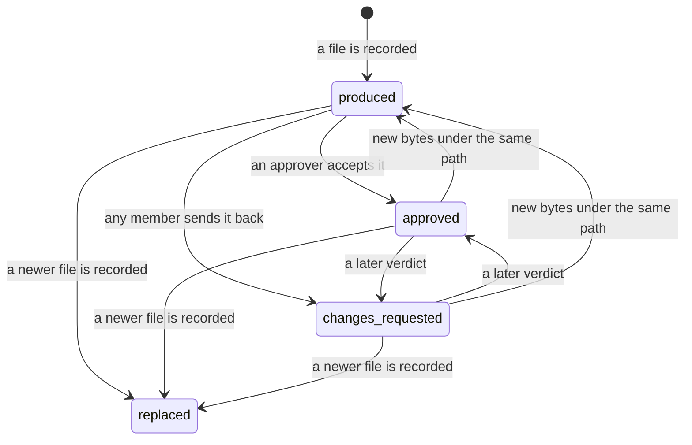

# File status — which file is the real one, and who accepted it

**Status:** built, not deployed (2026-11-18). Step 1 of three; steps 2 (a model judge) and 3 (its
calibration) are planned and described at the end. Code in `backend/src/storage/` (`file-status.ts`
the rules, `history.ts` the logic, `file-records*.ts` the store) and `backend/src/server/`
(`file-status.ts` the verdict tool, `file-audit.ts` the audit event, `documents.ts` the file list).

## The problem

A produced file had no state. The list of files for CI maths held 258 entries on 2026-11-18, and
nothing in it could answer three questions an expert asks every day:

- **Which file is the one in use?** Lesson 56 had two different French pupil files side by side, one
  from August under an older name. Its Wolof file (30 September) was older than the French it was
  meant to match (11 November). The list showed all of them the same way.
- **Has anyone accepted it?** There was no field for it. The evaluation grid was scored by the model
  and the score thrown away.
- **Who delivered it?** Recording a file was not in the audit trail at all.

A second problem sat underneath. Every file of a namespace was kept in **one** object,
`history.json`, read whole and written whole. Two sessions recording files at the same time each
saved their own copy, and the second erased the first's entry. With one person producing, that never
showed. With several, it would.

## The decision

**Every recorded file has a status, read off its own record.** A person's verdict is the only thing
set by hand; everything else follows from recording files.

| status | what it means | how a file gets there |
|---|---|---|
| `produced` | the file in use, no verdict yet | recorded with a document and a language |
| `approved` | an approver accepted these exact bytes | `record_file_verdict` |
| `changes_requested` | a person sent it back, with a note | `record_file_verdict` |
| `replaced` | a newer file took its place | automatic, when the newer one is recorded |
| `unfiled` | it names no document or no language | recorded without `documentId` or `variant` |

### One current file per lesson, document and language

A CI-maths lesson owes four files: the pupil book in French and Wolof, the teacher's guide in each.
"Lesson, document, language" is what tells them apart, so it is also what makes two files versions of
the same thing. Recording a file marks every older file with the same three as `replaced` and names
the newcomer on it (`replacedBy`). Both writes land together, so there is never a moment with two
current files or with none.

Worked example: record `V2-Lecon-56-composer-16-a-19-FR.docx` for lesson 56, pupil book, French. An
earlier `V2-Lecon-56-…-FR.docx` with the same three becomes `replaced`. The Wolof file and the
teacher's guide are untouched: a different language, a different document.

### `unfiled`, and why nothing is guessed

Of the first 100 live CI-maths entries read on 2026-11-18, 27 name no document: they were recorded
before `documentId` and `variant` existed. They cannot be the current file of anything, because
nothing says which document they are. They are
**never** matched by file name: classifying documents by name is what this module moved away from in
`graph-linked-documents.md`, and a wrong match would mark a good file replaced. They show as
`unfiled`, take no verdict, and become current the day they are recorded again with both fields.

### A verdict is a person's, and it is about exact bytes

`record_file_verdict` records `approved` or `changes_requested`, with who gave it and when.

- **Approving needs the approver role** (`approveDocuments`, the same tier as publishing). It is the
  sign-off, not the work.
- **Sending back needs only membership**, and a note. Anyone working on a lesson may say it is not
  ready; without a note the next person has nothing to act on.
- **The verdict names the bytes it was given on** (the file's md5). Recording new bytes under the
  same path returns the file to `produced`. Re-recording the *same* bytes, to correct the content
  record, keeps it.
- **Only a current file takes a verdict.** A `replaced` one is refused and the refusal names the file
  to judge instead. So is a file whose bytes in the bucket are no longer the ones recorded: the
  person would be approving something nobody recorded.
- **Several files, one confirmation, all or nothing.** "Approve the four files of lesson 23" is one
  call. If one file is refused, none is recorded.
- **A warning, not a refusal, for stale files.** The confirmation notice says when a file quotes
  curriculum that has changed since it was produced. The approver may know it does not matter.

The verdict is given in chat, so it is agent-mediated like every other confirmation here
(`self-serve-authoring.md`, risk 2). It rests on the same three things: the role comes from a signed
token, a later verdict replaces an earlier one, and every verdict is in the audit trail under the
person's name. The tool description tells the model to relay the verdict the person gave and never
to decide it.

### Status is read, never stored

`statusOf(entry)` computes the status from the record's fields each time. There is no `status` column
that could disagree with `replacedBy` or with the verdict's bytes, and no migration when a rule
changes.

## One record per file

Records moved from `history.json` to a database collection, one document per file
(`file_records`), with a small document per namespace beside them (`file_record_namespaces`).

**A write touches only the files it is about.** Recording lesson 23's Wolof file writes that record
and the one it replaces. It cannot erase lesson 24's.

**Reads stay cheap.** The namespace document carries a `revision` that every write moves, in the same
batch as the records. A read fetches that one small document; the records themselves (megabytes for
CI maths) are fetched again only when the revision has moved. The copy is shared by every session of
the process, where the old one was per session and never refreshed, which is how a session could
list files another session had already replaced.

**Every query is one equality on one field** (`namespace`). That is deliberate. A second condition
needs a composite index created by hand; the in-memory store the tests run on needs none, so such a
query passes every test and fails on the first live call. That has happened twice in this project.
Filtering and sorting happen in code.

### The one-time import

The first call that touches a namespace's records imports its `history.json`: every entry is written
as a record, then a marker is written. The marker is last, so a failed import leaves nothing
half-marked and the next call tries again; re-writing the same records is harmless. Two calls
arriving together share one import. After it, `history.json` is never read or written again. It
stays in the bucket exactly as it was, as the backup of that moment.

No script and no ordering to respect at deploy: the import runs when the namespace is first used.

### Reconcile only reports; dropping is a tool of its own

`reconcile` used to drop the record of every file gone from the bucket, in the same call that
reported it. It needed only the read permission and asked for no confirmation, and a dropped record
does not come back. Two things were wrong with that. Looking should not delete. And a tool tells its
client once, for every call, whether it only reads (`server/tool-effects.ts`): a `reconcile` that can
delete has to say so, and ChatGPT then asks the user before every plain check, while a read-only
account cannot run it at all. A `drop: true` argument on the same tool would not have helped, for the
same reason — one tool, one hint.

So there are two tools (2026-11-24):

- `reconcile` reports and changes nothing. The recorded files that are gone are listed under `gone`.
- `drop_missing_file_records` removes those records. It needs the write permission and a
  confirmation, and its unconfirmed call lists what would go (`wouldDrop`).

The stdio server's start-up reconcile only reports as well: starting a server deletes nothing.

One case is refused outright. When the bucket lists **no** document at all while records exist, that
is far more often a listing pointed at the wrong place than a bucket emptied on purpose. `reconcile`
reports it as `dropBlocked`; the drop tool removes nothing and answers `dropSkipped`.

The drop leaves no line in the audit trail yet (see "Not done").

## The audit trail

A new event type, `file`, records three things under the namespace the file lives in: a file was
`recorded` (with the files it replaced), `approved`, or `changes_requested` (with the note).
`read_audit` filters on it (`action: "file"`), so "who approved the Wolof guide of lesson 23" is one
read. The record is written after the file record, as membership events are; a failed trail write is
logged and does not undo the file write.

## What an expert sees

- `list_documents` puts `status` on every row, at every detail level. `current: true` returns only the
  files in use. `status` filters to one. `statusCounts` counts every status across the other filters,
  so `list_documents(nodeId)` says where a lesson stands in one call.
- `log_generation` and `record_document_content` answer with the file's status, the files it
  replaced, and what happens next.
- `record_file_verdict` is the one new tool.
- `get_capabilities` (`documents.fileStatus`) lists the statuses and verdicts from the storage module
  itself, and says whether the caller may approve.

## Not done

- **The plugin and the user guide** do not mention statuses yet. The tools describe themselves, so a
  session can use them, but the production skill does not yet end on "these four files are current,
  none approved". It goes with step 3, which touches the plugin anyway (one version bump).
- **Cleaning up the unfiled files.** They are visible and harmless, but there is no way to retire
  one short of recording it again. Whether to add one is a decision for the experts' first use.
- **`start_here` does not say "N files await a verdict".** It reads the graph and needs no role; file
  records are members-only. Worth adding once approvers use this.
- **Nothing blocks on a status.** A file can be delivered to print without being approved. Blocking
  is a policy for the team, not a default.
- **Dropping a record leaves no audit line.** `drop_missing_file_records` is confirmed and gated, but
  the trail does not yet say who dropped which records. A fourth `file` event would do it.

## Steps 2 and 3 — the judge

**Step 2.** A second model reads the finished pages of one file and answers each point of the
evaluation grid yes, no or cannot tell, quoting the passage, and checks each picture against the
words beside it. The result is stored on the file's record, next to the person's verdict. It never
approves; it adds flags. It is separate from the model that wrote the page: the server calls it,
in a fresh conversation, with only the page pictures, the grid and the curriculum.

**Step 3.** Before the judge is believed, it is run on lessons the experts have already corrected,
and its agreement with them is counted per grid point. Points below the bar become human-only. Each
grid point carries a switch saying whether a model may judge it, as data in the graph.

This step is what makes step 2 possible: the judge's result needs a file record to live on, and a
verdict to be compared with.

## Related

- [`graph-linked-documents.md`](graph-linked-documents.md) — a document's identity is the node it
  covers; why file names are never parsed
- [`evaluation-rubrics.md`](evaluation-rubrics.md) — the grids the judge will score against
- [`self-serve-authoring.md`](self-serve-authoring.md) — risk 2, the agent-mediated confirmation
- [`../technical-reference/generation-and-storage.md`](../technical-reference/generation-and-storage.md)
  — the operational description
