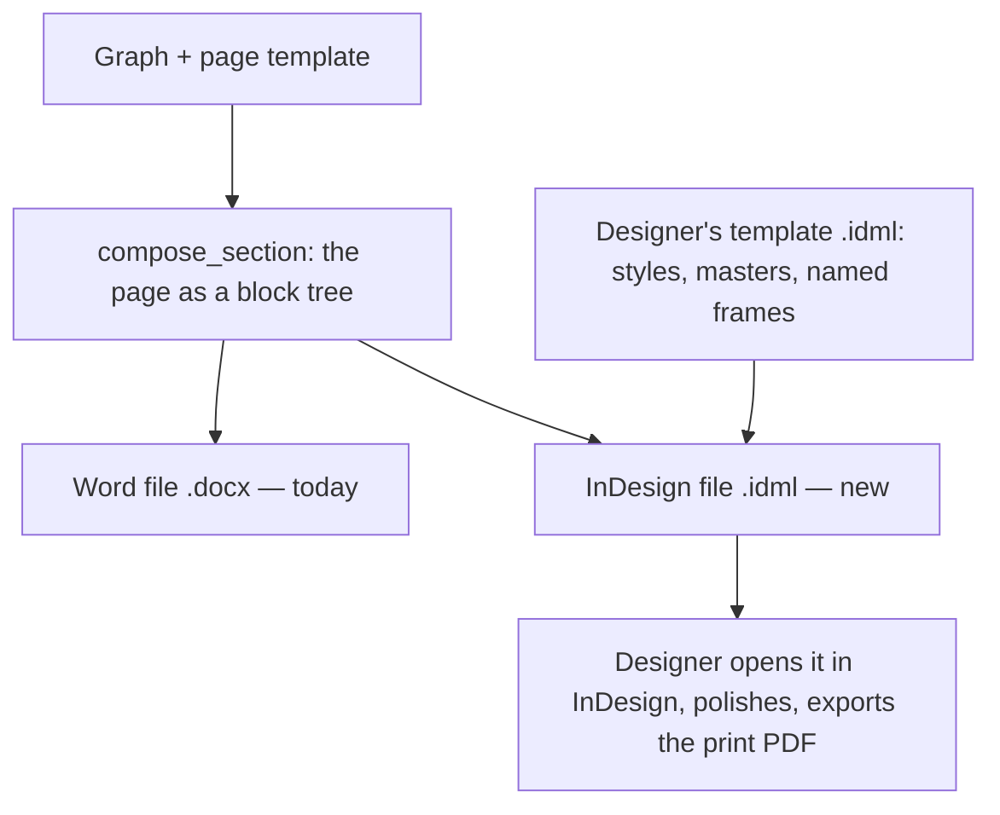

# InDesign export — the server writes an `.idml` the designer finishes

**Status:** Proposal (2026-10-27). Step 1, the styled template, is **built** — by script, since
there is no designer on this (`backend/scripts/indesign/build-gabarit.jsx`; what it produced and what
is left to check by eye are in the *Template checklist*). Step 2, the one-lesson spike, **worked**:
InDesign opened a server-written file of lesson 1 on the first try — see *Spike result*. The
renderer itself is not built.

## The problem

The pupil book is laid out by a designer in **Adobe InDesign**, not in Word. The pilot file,
`Pilote Maths OE 3 1 à 10.indd` (lessons 1–10 of the CI maths pupil book, in Wolof), is that book.
Today the server's only output is a Word file (`render_document` → `.docx`, see
[`renderer-spike.md`](../renderer-spike.md)). So between the graph and the printer there is a person
who retypes, or pastes, every directive and re-places every picture by hand. Every correction made
in the graph has to be carried into InDesign the same way. That is the step this note removes.

## What the pilot file is today

Read from an IDML export of the file on 2026-10-27. InDesign was driven by script and the `.indd`
was not saved.

| | What it is | What that means for us |
|---|---|---|
| Page | 200 × 275 mm, 13 pages: a cover, then about one page per lesson, plus integration pages | One lesson fits one page. Our Word book keeps two, by design; the InDesign book overrides the break (see *Decisions*) |
| Masters | 7 master pages, one per maths domain: `A-AN`, `B-Géo`, `C-Mesure`, `D-RP`, `E-INT AN`, `F-INT GEO`, plus `A-Gabarit` | The domain picks the master and its colour. In the graph that is the lesson's grouping |
| Styles | **One** paragraph style (`puces`). Every other piece of text is formatted by hand, in Andika | Nothing can be filled by a program until the styles exist. That is step 1 |
| Colours | Only one colour is named (`Activite Numerique`). The other domains use raw CMYK values | The domain colours need names too |
| Text | Each directive is its own free-floating text frame (about 15 per spread), not linked to the others | There is no flow: moving one item means moving everything under it by hand |
| Pictures | 409 picture placements, **all linked** to files in `Links/` (9 links are missing in the pilot itself). The file weighs 111 MB from the previews InDesign keeps of each link | Linked is what we need: we supply our pictures the same way |
| Picture rows | Each cell of a 3-picture row is its own frame. The answer signs (☒ ◯ ⊖) are small vector drawings, repeated under every cell | We hold the row as one assembled picture (`bande`), and that is what we send (see *Decisions*) |
| *Je retiens* | Composed by hand: an oval plus a dozen small fruit pictures placed one by one | We hold it as one picture, and send that |
| Text formatting | Andika throughout: 12 pt for questions, directives and labels; 14 pt bold for the title; 9 pt for the footer. **Text is black or white in every domain**; only the coloured *frames* (title band, number tab, evaluation box, markers) change with the domain | Paragraph styles are shared; the per-domain set is object and table styles (see *Decisions*, 3) |

The page is the same grid every time, and it is the grid our pupil page template already describes
(`backend/test/fixtures/senegal-pupil-layout.json`, see [`layout-templates.md`](../layout-templates.md)):

| On the InDesign page | In our page template |
|---|---|
| Title tab « Lesoŋ 1 » + title band | `en-tete` line |
| Opening questions + large scene | *Je fais*: `question-orale` lines + `amorce` picture |
| ★ ▲ ■ + directive + picture row | *Nous faisons*: `repere` marker + `directive` + `bande` picture |
| Pink box with the lamp icon | *Je retiens*: `encadre` table + `je-retiens` picture |
| ● ♥ ☾ + directive + picture row | *Tu fais*: same as *Nous faisons* |
| Left-margin icons (teacher, pupils, pencil) | `picto-section` pictures |

So the server already knows what goes on each page and in what order. What it lacks is a way to
write it in InDesign's format.

## The decision

**The server writes an InDesign file (`.idml`) from the same page tree it already composes, inside
a template the designer owns.** The designer opens it, polishes it, and exports the print PDF.

IDML is InDesign's own open format: a zip of XML files, documented by Adobe, which InDesign opens
like a normal document. The server can write it without InDesign installed. It is the same
situation as Word: the server writes `.docx` without Word.

Two other routes were considered and set aside:

- **A script inside InDesign that pulls each page from the server.** It works, but the page logic
  would live in a script on one designer's machine, outside this repo and its tests. That is the
  situation the renderer spike was written to get out of (`fiche.py`, lost with its laptop).
- **Adobe's cloud data merge** (the InDesign tools on the Adobe connector). It fills a fixed set of
  fields per record. Our pages have 2 to 4 items, 3 or 4 pictures per row, and an optional box, so a
  fixed set of fields does not fit.

### Where the geometry lives

The rule from [`formatter-render-spec.md`](../formatter-render-spec.md) holds: **no colour, size or
position in code.** For Word, the geometry sits in the formatter's `render` bag. For InDesign, it sits
in the **designer's template file**. The formatter only points at that file. For example, the
pupil formatter would gain
`render.indesign.template: "assets/gabarit-eleve.idml"`, a path in the namespace's bucket.

The template file is the contract. It must contain (the template built in step 1 has all of these;
the *Template checklist* lists them by name):

- **Paragraph and character styles named exactly as the formatter's styles**: `en-tete`,
  `directive`, `question-orale`, …. A block with `style: "directive"` becomes a paragraph with the
  InDesign style `directive`. If the template has no style of that name, the export is **refused**,
  naming the style. An unstyled page that looks finished is the failure the Word renderer already
  refuses.
  The header is the one exception: the pilot sets it as two frames (the tab « Lesoŋ 1 » and the
  title band), so our single `en-tete` line becomes two styles, `numero-lecon` and `titre-lecon`.
  The pilot also uses `evaluation`, `etiquette` and `pied-de-page`, which our Word template does not.
  The InDesign book's formatter `layout` uses those names.
- **Object styles named after the picture roles**: `amorce`, `bande`, `je-retiens`, `picto-section`.
  The size and the text wrap of each picture come from its object style.
- **Object styles for the coloured frames, one set per domain**: `AN/bandeau-titre`,
  `AN/onglet-numero`, `AN/encadre-evaluation`, `AN/repere`, and the same under `GEO/`, `MESURE/`, `RP/`.
- **A table style `encadre` per domain** (`AN/encadre`, …) for the *je retiens* box.
- **Master pages named per domain** and **named colours** per domain.
- **One model page with named frames**: `numero-lecon`, `titre-lecon` and `corps`. The first two
  are filled per lesson. `corps` is where the rest of the page flows.

### Where the template sits in the authoring workflow

**On the formatter, so per kind of document, not per subject and not in the graph guide.**

The graph guide is prose that the authoring model reads. A designer's file has nothing to say to a
model, so it does not belong there. The formatter is where a document's look already lives: its
`render` bag (Word geometry) and its `layout` (which blocks go on the page). The InDesign template
is a third piece of the same thing, so it goes beside them.

That gives the reuse we want without inventing anything:

- **One template per design, shared through the catalog.** A formatter is a catalog entry, attached
  to a document with `use_formatter`. If the CI and CP pupil books share one design, they share one
  formatter, and therefore one template file. The CI teacher guide has a different design, so it
  has a different formatter and a different template.
- **One document can differ when it needs to.** Formatters merge closest-first: a section's own
  setting wins over its document's, and its document's wins over the catalog default
  (`resolveRenderSpec`). A one-off book gets its own copy of the formatter, pointing at its own
  template, and nothing else changes.
- **The subject and the grade are not the key.** A subject can have two designs (pupil book, teacher
  guide), and two grades can share one. The key is the design, which is what the formatter names.

How the file gets there, in the order an expert meets it:

1. Someone produces `gabarit-eleve.idml` — today, the build script on a Mac with InDesign; later,
   perhaps a designer.
2. A curator uploads it to the workspace bucket (`create_media_upload_url`, under `assets/`). Then
   they point the formatter at it with `edit_nodes` — `render.indesign.template`. This is the plugin's
   *composer un document › changer la mise en forme* step, which already covers the `render` bag.
3. When the template is set, the server reads its style names and checks them against the
   formatter's: every `style` and picture `role` used by the formatter's `layout` must exist in the
   file. A missing name is refused at that moment, not at export. This is the same rule the `render`
   bag already follows.
4. `check_document` gains one line: *InDesign template — set / missing / names it lacks*, naming
   `edit_nodes` as the verb that closes the gap.

When the designer changes the template, they upload a new version and the formatter points at it.
The next export uses it. Files already produced keep the version they were made with.

### How a page is written

1. Copy the template's styles, colours, fonts and masters into the new file unchanged.
2. For each lesson, add a page on the master of its domain, cloned from the model page.
3. Fill `numero-lecon` and `titre-lecon`.
4. Write every other block, in order, into **one story that flows through `corps`**:
   - a line → a paragraph in its style;
   - a picture → an anchored frame, sized by its role's object style;
   - a table → an InDesign table.

   Because it is one flow, InDesign does the layout: a longer directive pushes the rest down, the way
   it does in Word. The alternative — the server computing the position of every frame — would mean
   writing our own layout engine. With fixed positions, nothing could tell us that a frame's text
   overflows without opening InDesign anyway.
5. `pageBreak: "before"` → the paragraph starts on the next page. The language variants (`fr`, `wo`)
   give one file each, as they do for Word (`render/variants.ts`).

### Pictures

An IDML file links to pictures by file path. It cannot reach `gs://`. So the export is a **zip
"package"**, like InDesign's own *File › Package*: the `.idml`, a `Links/` folder holding every
picture the page names (read off its `Material` node, as `render_document` already does), and the
list of fonts. When InDesign opens the file and finds a link missing, it looks in the `Links/` folder
next to the document. *To verify in the spike.*

Vector pictures (the SVG pictograms and markers) can stay vector: InDesign places SVG. Word could
not, which is why `render/raster.ts` exists.

### Reading corrections back

The Word renderer writes each block's graph node id into the file as an invisible content control,
so that a corrected file can be read back (`propose_from_document`). In InDesign the equivalent is
**XML tagging**: each paragraph or frame is tagged with an element carrying `nodeId`. InDesign keeps
the tags when a person edits around them, and they are readable from the IDML. That is what would let
a correction made in InDesign come back into the graph. It is a later phase, but the tags are written
from the start, so that files produced now can be read later.

### Checking that a page fits

This is the one thing the server cannot do alone. Only InDesign composes an InDesign page. There are
three ways to get that measure:

| Route | What it is | Cost |
|---|---|---|
| InDesign on a Mac, driven by script | What this note used: open the file, read the page count and any text that overflows its frame | Free; needs the Mac and someone to run it |
| Adobe InDesign APIs | Adobe's cloud service that runs InDesign | Paid; to price |
| InDesign Server | A server licence | Expensive; not for a pilot |

Phase 1 uses the first. The designer opens the file anyway, and InDesign marks an overflowing frame
with a red `+`.

## Decisions (2026-10-27)

Settled with the user.

1. **One lesson, one page — in the InDesign book only.** The designer's pilot fits each lesson on
   one page. The Word pupil book (« Outil de l'élève ») stays at two: its formatter says so (« sur
   deux pages ») and its page template breaks before *Tu fais*. Both books share that template, so
   the break is **not** removed from it. Instead, the InDesign book's own formatter carries a
   `tu-fais` template without the break. When two formatters define a template with the same name,
   the one closest to the document wins (`resolveLayout`), so only the InDesign book changes. That
   override is written when the InDesign formatter is created, in step 3; nothing changes in the
   graph before then.
2. **A row of pictures arrives as one combined image**, the `bande` the graph already holds with its
   ☒ ◯ ⊖ signs. It needs no new data. The designer moves the row as a whole. Splitting rows into
   separate cells stays possible later if the designer finds they adjust single cells often.
3. **One style set per domain.** In InDesign a style has a fixed colour; it cannot take one from
   the page. So the styles that carry the domain colour are grouped by domain and the server picks
   the group from the lesson's unit, looking in that group first and then at the top level. Reading
   the pilot settled *which* styles those are: its text is black or white in every domain, so the
   **paragraph styles are shared**. What changes colour is the frames — title band, number tab,
   evaluation box, markers, *je retiens* box — so the per-domain set is `AN/bandeau-titre`,
   `GEO/bandeau-titre`, …, object and table styles.
4. **The template lives in the workspace's own file storage**, under `assets/`, next to the
   pictograms. A formatter copied into another workspace keeps pointing at the original file until
   someone copies the file too. There is no shared storage across workspaces, and this does not
   need one.

## The plan

| Step | Who | Result |
|---|---|---|
| 1. Styled template | **Done** — build script, in InDesign | `gabarit-eleve.idml` with the named styles, colours and the model page; see *Template checklist* |
| 2. Spike | **Done** — `backend/scripts/indesign/spike-idml.mjs` | Lesson 1 from `compose_section`, written into the template, opened in InDesign. One page, nothing overflowing; see *Spike result* |
| 3. Renderer | Server | `render/idml.ts` beside `render/docx.ts`; `render_document` gains `format: "idml"` and returns the package |
| 4. Measure | Server + Mac | A script that opens the file in InDesign and reports pages and overflowing text, like `measure:true` |
| 5. Read back | Server | `propose_from_document` reads the tags from a corrected `.idml` |

Step 2 was the real test, and it passed: the plan stands.

## Spike result (2026-10-27)

`spike-idml.mjs` took lesson 1's page exactly as `compose_section` returns it (13 blocks and 12
pictures, copied unchanged into `lecon-1.tree.json`) and wrote it into the template. It kept the
styles, colours, masters and model page, and filled the three named frames. No InDesign was involved
in writing it. The result sits next to the pilot, under `gabarit/spike-lecon-1/`.

**What worked, first time:**

- **InDesign opened the file without complaint.** It produced 1 page, all 14 picture links resolved,
  and no frame overflowed. The file is 171 KB; the template it came from is 116 MB.
- **The template carried the look.** The pink margin band and the footer came from the master page,
  the coloured number tab and title band from the `AN/` object styles, and the text from the
  paragraph styles. The renderer chose none of these.
- **One flowing story was enough.** Paragraphs, inline pictures and tables in a single `corps`
  story laid themselves out, and the lesson fits on one page with room to spare.

**What differed from the pilot on the first run, and how it was closed (second run, same day):**

| Difference | Fix | Where it lives |
|---|---|---|
| Each directive sat *above* its picture row; the pilot puts it to the *left* | **Closed.** A borderless two-column grid, `item` (7 cm + 10 cm), per directive and its row; the opening questions use it too, without a box, as in the pilot. The spike applies it to the shared tree; for real it is the InDesign book's own `nous-faisons` / `tu-fais` / `je-fais` templates | Graph data (the formatter's `layout`) + an `item` table style in the template |
| The section pictograms sat in the text column; the pilot hangs them in the left margin | **Closed.** The `picto-section` object style carries the anchored position (5 mm from the page edge), so the renderer writes no position. One renderer rule: a picture whose style anchors it outside the column rides the next line instead of taking a line of its own | Template + one renderer rule |
| The boxes had thin black borders | **Closed.** Every cell and table style is set to no rules; a new style otherwise inherits InDesign's 1 pt black edges | Template |
| A closing « » » wrapped onto its own line | **Closed.** A no-break space before « ? ! : ; » » and after « « » | Renderer (it applies to Word too) |
| The narrow column hyphenated « en-semble », « nom-breux » | **Closed.** Hyphenation off in the body styles | Template |
| Numbered orange squares (1, 2, 3) instead of ★ ▲ ■ ● ♥ | The InDesign book's formatter names other marker files | Graph data |
| The *je retiens* box is empty, and *Tu fais* ③ has no picture row | `L01-je-retiens.png` is missing from the bucket, and nothing is attached to ③ (`compose_section` reported both) | The graph's own gaps, not the renderer's |
| French instead of Wolof | The same `translateInto` the Word renderer uses | Renderer |
| The pilot prints its last item in a red evaluation box; ours prints *Tu fais* ③ as a plain item — and it is the same question | Decide whether ③ becomes the evaluation box in the InDesign book | To decide |

**Three things the renderer must do, learnt the hard way:**

- **Ship the fonts with the file.** Opened away from the template's `Document fonts/` folder,
  InDesign silently substituted Andika. The package must include the fonts, next to the `.idml`.
- **Check the margin offset on a right-hand page.** InDesign placed the icon at −5 mm for an
  offset of +5 mm from the page edge, so the template uses −5. That was measured on a left-hand page
  only; the first multi-page book must check a right-hand one.
- **SVG is untested.** The pictograms were rasterised to PNG for the spike. Whether an IDML can link
  an SVG directly is still open; InDesign places SVG when a person does it.

## Template checklist

What step 1 has to produce, and where it stands. Built on 2026-10-27 by
`backend/scripts/indesign/build-gabarit.jsx` from a copy of the pilot; the pilot itself is not
modified (checked by checksum). Output in the pilot's folder, under `gabarit/`: `gabarit-eleve.indd`,
`.indt`, `.idml`, three preview pages and `rapport.txt`.

**Built and checked**

- [x] **7 paragraph styles**, each copied from a real paragraph of the pilot: `numero-lecon` (Andika
  Bold 12, white), `titre-lecon` (Andika Bold 14, white, capitals), `question-orale`, `directive`,
  `etiquette` (Andika Regular 12, black), `evaluation` (Andika Regular 12, white), `pied-de-page`
  (Andika Regular 9, black).
- [x] **Applied to the pilot's pages**: 121 text frames on the lesson pages and 28 footer frames on
  the masters. Applied *without* clearing the hand formatting, and each paragraph's look put back
  after. The first try cleared it and slid directives under their ★ ▲ ● markers, because their
  indent came from the old `puces` style. Pages 2 and 4 were compared with the pilot and match.
- [x] **Domain colours named**: `Activite Numerique`, `Geometrie`, `Mesure`,
  `Resolution de problemes`.
- [x] **Object styles**: `amorce`, `bande`, `je-retiens`, `picto-section`, and per domain
  `bandeau-titre`, `onglet-numero`, `encadre-evaluation`, `repere`. Each touches only fill, stroke and
  paragraph style: a new object style switches every category on, and applying one reset the
  markers' text wrap. 96 coloured frames and markers on the pilot pages are tagged with them.
- [x] **Table and cell style `encadre`** per domain.
- [x] **7 master pages** kept as they are.
- [x] **Model page** (page 14, master `A-AN`) with three named frames: `numero-lecon`, `titre-lecon`,
  `corps`.
- [x] **Pictures are linked**, not embedded, so there is nothing to unembed. An earlier reading of
  this note said 97 were embedded; that was wrong.

**Left to check or decide**

- [ ] The *je retiens* box fill is set at 25% of the domain colour, by eye. Compare it with the
  pilot's pink before relying on it.
- [ ] Title-band tint differs between domains in the pilot (70% for AN and Mesure, 60% for RP, 100%
  for Géo). The template keeps what each domain's first page uses. Decide whether that is intended
  or should be one tint.
- [ ] 9 picture links are missing in the pilot itself (`bouteille d'eau.png`, `devant:derrière.psd`,
  `garcon:fille 9.png`, `fille2:garcon1.png`). They do not affect the template; they affect only the
  pilot's own sample pages.
- [ ] The pictures' size per role (`amorce` about 99 × 49 mm in the pilot, a picture row about
  100 × 22 mm, a pictogram 13 mm) is not in the object styles yet. Step 2 decides whether size lives
  in the object style or in the formatter's `render` bag.
- [ ] The template is 116 MB because it still carries the pilot's 13 pages as samples. The export
  only needs its styles, masters and model page; step 2 decides whether to strip the samples.
