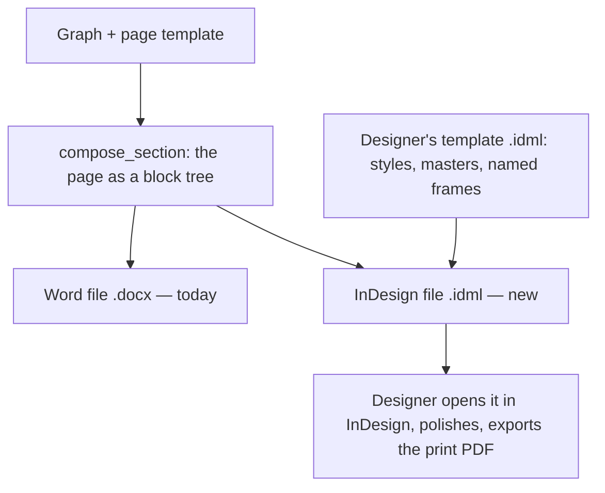

# InDesign export — the server writes an `.idml` the designer finishes

**Status:** Proposal (2026-10-27). Nothing is built. Step 1 — the designer turns the pilot file into
a styled template — is described in [`brief-maquettiste.md`](brief-maquettiste.md) (French, for the
designer). The four decisions the spike needed are settled — see *Decisions*.

## The problem

The pupil book is laid out by a designer in **Adobe InDesign**, not in Word. The pilot file,
`Pilote Maths OE 3 1 à 10.indd` (lessons 1–10 of the CI maths pupil book, in Wolof), is that book.
Today the server's only output is a Word file (`render_document` → `.docx`, see
[`renderer-spike.md`](../renderer-spike.md)). So between the graph and the printer there is a person
who retypes, or pastes, every directive and re-places every picture by hand. Every correction made
in the graph has to be carried into InDesign the same way. That is the step this note removes.

## What the pilot file is today

Read from an IDML export of the file on 2026-10-27. InDesign was driven by script and the `.indd`
was not saved.

| | What it is | What that means for us |
|---|---|---|
| Page | 200 × 275 mm, 13 pages: a cover, then about one page per lesson, plus integration pages | One lesson fits one page. Our Word template breaks before *Tu fais* and so gives two (see *Decisions*) |
| Masters | 7 master pages, one per maths domain: `A-AN`, `B-Géo`, `C-Mesure`, `D-RP`, `E-INT AN`, `F-INT GEO`, plus `A-Gabarit` | The domain picks the master and its colour. In the graph that is the lesson's grouping |
| Styles | **One** paragraph style (`puces`). Every other piece of text is formatted by hand, in Andika | Nothing can be filled by a program until the styles exist. This is the designer's step 1 |
| Colours | Only one colour is named (`Activite Numerique`). The other domains use raw CMYK values | The domain colours need names too |
| Text | Each directive is its own free-floating text frame (about 15 per spread), not linked to the others | There is no flow: moving one item means moving everything under it by hand |
| Pictures | About 150 pictures, **97 embedded** in the file (that is why it weighs 111 MB) | Pictures must be **linked** files, so we can supply them |
| Picture rows | Each cell of a 3-picture row is its own frame. The answer signs (☒ ◯ ⊖) are small vector drawings, repeated under every cell | We hold the row as one assembled picture (`bande`), and that is what we send (see *Decisions*) |
| *Je retiens* | Composed by hand: an oval plus a dozen small fruit pictures placed one by one | We hold it as one picture. The designer may keep composing it |

The page is the same grid every time, and it is the grid our pupil page template already describes
(`backend/test/fixtures/senegal-pupil-layout.json`, see [`layout-templates.md`](../layout-templates.md)):

| On the InDesign page | In our page template |
|---|---|
| Title tab « Lesoŋ 1 » + title band | `en-tete` line |
| Opening questions + large scene | *Je fais*: `question-orale` lines + `amorce` picture |
| ★ ▲ ■ + directive + picture row | *Nous faisons*: `repere` marker + `directive` + `bande` picture |
| Pink box with the lamp icon | *Je retiens*: `encadre` table + `je-retiens` picture |
| ● ♥ ☾ + directive + picture row | *Tu fais*: same as *Nous faisons* |
| Left-margin icons (teacher, pupils, pencil) | `picto-section` pictures |

So the server already knows what goes on each page and in what order. What it lacks is a way to
write it in InDesign's format.

## The decision

**The server writes an InDesign file (`.idml`) from the same page tree it already composes, inside
a template the designer owns.** The designer opens it, polishes it, and exports the print PDF.

IDML is InDesign's own open format: a zip of XML files, documented by Adobe, which InDesign opens
like a normal document. The server can write it without InDesign installed. It is the same
situation as Word: the server writes `.docx` without Word.

Two other routes were considered and set aside:

- **A script inside InDesign that pulls each page from the server.** It works, but the page logic
  would live in a script on one designer's machine, outside this repo and its tests. That is the
  situation the renderer spike was written to get out of (`fiche.py`, lost with its laptop).
- **Adobe's cloud data merge** (the InDesign tools on the Adobe connector). It fills a fixed set of
  fields per record. Our pages have 2 to 4 items, 3 or 4 pictures per row, and an optional box, so a
  fixed set of fields does not fit.

### Where the geometry lives

The rule from [`formatter-render-spec.md`](../formatter-render-spec.md) holds: **no colour, size or
position in code.** For Word, the geometry sits in the formatter's `render` bag. For InDesign, it sits
in the **designer's template file**. The formatter only points at that file. For example, the
pupil formatter would gain
`render.indesign.template: "assets/gabarit-eleve.idml"`, a path in the namespace's bucket.

The template file is the contract. It must contain:

- **Paragraph and character styles named exactly as the formatter's styles**: `en-tete`,
  `directive`, `question-orale`, …. A block with `style: "directive"` becomes a paragraph with the
  InDesign style `directive`. If the template has no style of that name, the export is **refused**,
  naming the style. An unstyled page that looks finished is the failure the Word renderer already
  refuses.
  The header is the one exception: the designer sets it as two frames (the tab « Lesoŋ 1 » and the
  title band), so our single `en-tete` line becomes two styles, `numero-lecon` and `titre-lecon`.
  The brief also asks for `evaluation`, `etiquette` and `pied-de-page`, which the pilot uses and our
  Word template does not. The pupil formatter's `layout` gains those names when the template arrives.
- **Object styles named after the picture roles**: `amorce`, `bande`, `je-retiens`, `picto-section`,
  `repere`. The size and the text wrap of each picture come from its object style.
- **A table style `encadre`** for the boxes.
- **Master pages named per domain**, **named colours** per domain, and the styles that change
  colour **grouped by domain** (`AN/…`, `GEO/…`; see *Decisions*).
- **One model page with named frames**: `numero-lecon`, `titre-lecon` and `corps`. The first two
  are filled per lesson. `corps` is where the rest of the page flows.

### Where the template sits in the authoring workflow

**On the formatter, so per kind of document, not per subject and not in the graph guide.**

The graph guide is prose that the authoring model reads. A designer's file has nothing to say to a
model, so it does not belong there. The formatter is where a document's look already lives: its
`render` bag (Word geometry) and its `layout` (which blocks go on the page). The InDesign template
is a third piece of the same thing, so it goes beside them.

That gives the reuse we want without inventing anything:

- **One template per design, shared through the catalog.** A formatter is a catalog entry, attached
  to a document with `use_formatter`. If the CI and CP pupil books share one design, they share one
  formatter, and therefore one template file. The CI teacher guide has a different design, so it
  has a different formatter and a different template.
- **One document can differ when it needs to.** Formatters merge closest-first: a section's own
  setting wins over its document's, and its document's wins over the catalog default
  (`resolveRenderSpec`). A one-off book gets its own copy of the formatter, pointing at its own
  template, and nothing else changes.
- **The subject and the grade are not the key.** A subject can have two designs (pupil book, teacher
  guide), and two grades can share one. The key is the design, which is what the formatter names.

How the file gets there, in the order an expert meets it:

1. The designer delivers `gabarit-eleve.idml`.
2. A curator uploads it to the workspace bucket (`create_media_upload_url`, under `assets/`). Then
   they point the formatter at it with `edit_nodes` — `render.indesign.template`. This is the plugin's
   *composer un document › changer la mise en forme* step, which already covers the `render` bag.
3. When the template is set, the server reads its style names and checks them against the
   formatter's: every `style` and picture `role` used by the formatter's `layout` must exist in the
   file. A missing name is refused at that moment, not at export. This is the same rule the `render`
   bag already follows.
4. `check_document` gains one line: *InDesign template — set / missing / names it lacks*, naming
   `edit_nodes` as the verb that closes the gap.

When the designer changes the template, they upload a new version and the formatter points at it.
The next export uses it. Files already produced keep the version they were made with.

### How a page is written

1. Copy the template's styles, colours, fonts and masters into the new file unchanged.
2. For each lesson, add a page on the master of its domain, cloned from the model page.
3. Fill `numero-lecon` and `titre-lecon`.
4. Write every other block, in order, into **one story that flows through `corps`**:
   - a line → a paragraph in its style;
   - a picture → an anchored frame, sized by its role's object style;
   - a table → an InDesign table.

   Because it is one flow, InDesign does the layout: a longer directive pushes the rest down, the way
   it does in Word. The alternative — the server computing the position of every frame — would mean
   writing our own layout engine. With fixed positions, nothing could tell us that a frame's text
   overflows without opening InDesign anyway.
5. `pageBreak: "before"` → the paragraph starts on the next page. The language variants (`fr`, `wo`)
   give one file each, as they do for Word (`render/variants.ts`).

### Pictures

An IDML file links to pictures by file path. It cannot reach `gs://`. So the export is a **zip
"package"**, like InDesign's own *File › Package*: the `.idml`, a `Links/` folder holding every
picture the page names (read off its `Material` node, as `render_document` already does), and the
list of fonts. When InDesign opens the file and finds a link missing, it looks in the `Links/` folder
next to the document. *To verify in the spike.*

Vector pictures (the SVG pictograms and markers) can stay vector: InDesign places SVG. Word could
not, which is why `render/raster.ts` exists.

### Reading corrections back

The Word renderer writes each block's graph node id into the file as an invisible content control,
so that a corrected file can be read back (`propose_from_document`). In InDesign the equivalent is
**XML tagging**: each paragraph or frame is tagged with an element carrying `nodeId`. InDesign keeps
the tags when a person edits around them, and they are readable from the IDML. That is what would let
a correction made in InDesign come back into the graph. It is a later phase, but the tags are written
from the start, so that files produced now can be read later.

### Checking that a page fits

This is the one thing the server cannot do alone. Only InDesign composes an InDesign page. There are
three ways to get that measure:

| Route | What it is | Cost |
|---|---|---|
| InDesign on a Mac, driven by script | What this note used: open the file, read the page count and any text that overflows its frame | Free; needs the Mac and someone to run it |
| Adobe InDesign APIs | Adobe's cloud service that runs InDesign | Paid; to price |
| InDesign Server | A server licence | Expensive; not for a pilot |

Phase 1 uses the first. The designer opens the file anyway, and InDesign marks an overflowing frame
with a red `+`.

## Decisions (2026-10-27)

Settled with the user, so the designer's brief now states them rather than asks.

1. **One lesson, one page.** The designer's pilot is the book that gets printed, and it fits each
   lesson on one page. Our Word page template breaks before *Tu fais* and so gives two pages. That
   break is removed from the pupil formatter's `layout` (a graph edit, separate from this note).
2. **A row of pictures arrives as one combined image**, the `bande` the graph already holds with its
   ☒ ◯ ⊖ signs. It needs no new data. The designer moves the row as a whole. Splitting rows into
   separate cells stays possible later if the designer finds they adjust single cells often.
3. **One style set per domain.** In InDesign a paragraph style has a fixed colour; it cannot take
   one from the page. So the designer groups the styles by domain — `AN/titre-lecon`,
   `GEO/titre-lecon`, and so on — and the server picks the group from the lesson's unit. A style
   whose colour does not change across domains (a directive in black) can live once, outside any
   group: the server looks in the lesson's group first, then at the top level.
4. **The template lives in the workspace's own file storage**, under `assets/`, next to the
   pictograms. A formatter copied into another workspace keeps pointing at the original file until
   someone copies the file too. There is no shared storage across workspaces, and this does not
   need one.

## The plan

| Step | Who | Result |
|---|---|---|
| 1. Styled template | Designer, following the brief | `gabarit-eleve.idml` with the named styles, frames and colours, and lesson 1 rebuilt on them |
| 2. Spike | Server | Lesson 1 written by hand-made code from `compose_section`'s tree into the template. Opened in InDesign and compared with the designer's page 2 |
| 3. Renderer | Server | `render/idml.ts` beside `render/docx.ts`; `render_document` gains `format: "idml"` and returns the package |
| 4. Measure | Server + Mac | A script that opens the file in InDesign and reports pages and overflowing text, like `measure:true` |
| 5. Read back | Server | `propose_from_document` reads the tags from a corrected `.idml` |

Step 2 is the real test. If one lesson does not come out close to the designer's page, the rest of
the plan changes.
